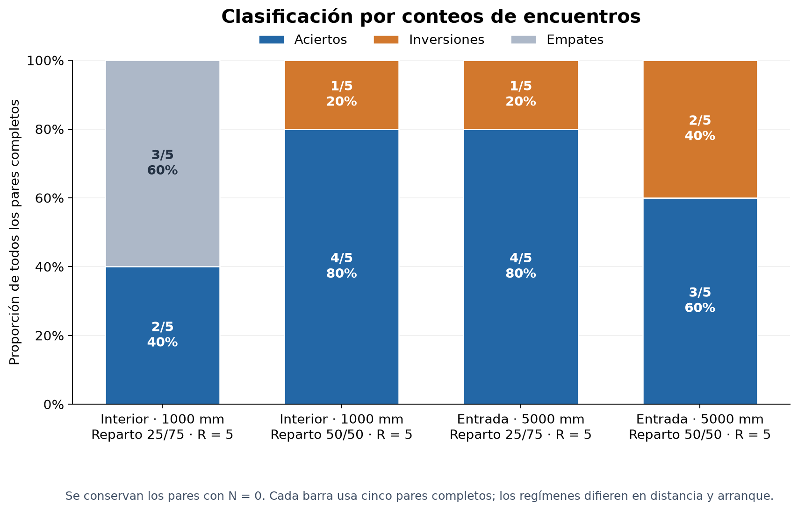
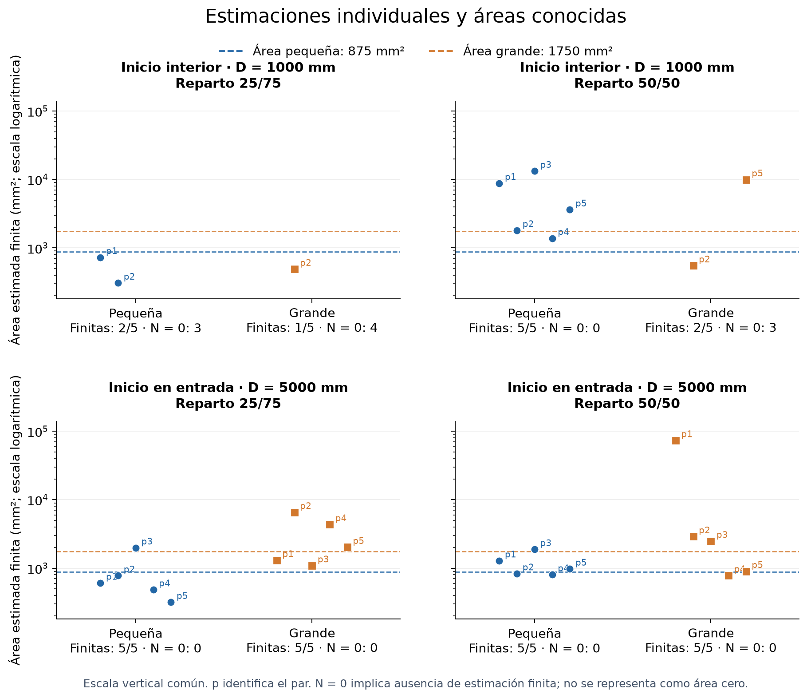
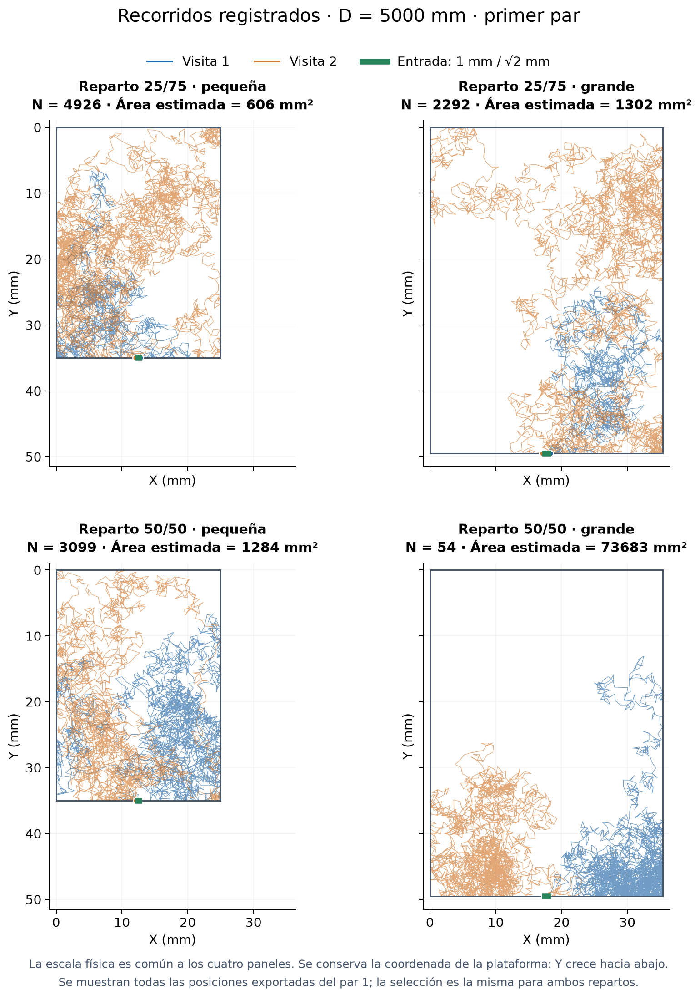
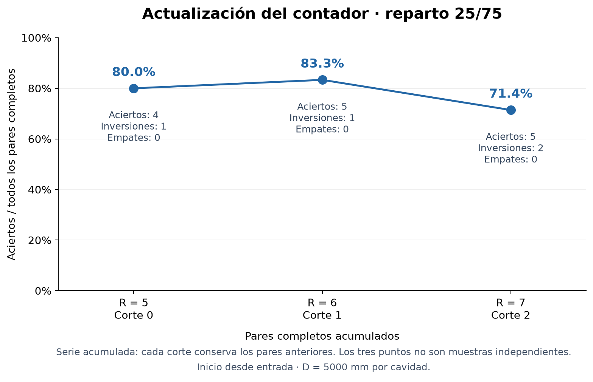
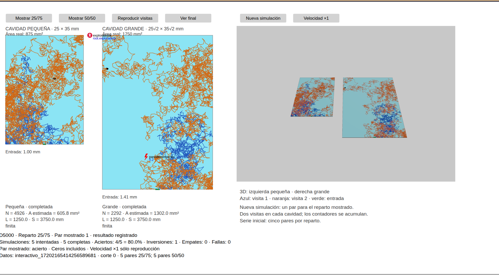

# Reporte de avance: exploración y estimación de cavidades

**Modelo en AnyLogic · 26 de noviembre de 2026**

## Abrir el proyecto de AnyLogic

Se incluye la [carpeta editable del modelo](modelo_anylogic/) y un [archivo ZIP para revisión](entrega/Proyecto_AnyLogic.zip). Se descarga y extrae la carpeta, se abre `Exploradora3D_Interactivo.alp` en **AnyLogic 8.9.10** y se ejecuta `Simulation`. El [LEEME del modelo](modelo_anylogic/LEEME.md) describe los controles, los resultados exportados y las condiciones de uso.

La copia de entrega guarda las nuevas sesiones en una carpeta relativa `resultados`, dentro del directorio de trabajo del proceso. Conserva las reglas, parámetros y semillas de la versión que produjo los datos del avance; sólo se adaptaron las rutas de archivos para trasladarla a otro equipo. Los resultados nativos ya obtenidos se distinguen de esta copia portable. Su apertura y ejecución en el equipo receptor deben comprobarse allí.

Esta entrega corresponde a una actividad docente de Simulación II. Se acompaña el [acuerdo de usuario final de AnyLogic](modelo_anylogic/ANYLOGIC_MODEL_END_USER_AGREEMENT.txt), que debe leerse y aceptarse antes del uso. También se incluye el [informe del avance en PDF](documentos/Avance_2026-11-26.pdf).

## Pregunta de investigación

> Si la exploradora recorre la misma distancia total en dos visitas, ¿cambia la frecuencia con la que el conteo de cruces le permite distinguir la cavidad pequeña de la grande según cómo reparta esa distancia?

## 1. Avance desarrollado

Se implementó un modelo de una exploradora simulada que realiza dos visitas a cada cavidad. En la primera se registra un rastro geométrico y en la segunda se cuentan los encuentros con ese recorrido. A partir de las longitudes y del conteo se obtiene una estimación del área. El avance incluye una representación en planta y en 3D, exportación de datos por visita y por par, y controles para generar nuevas simulaciones y consultar los resultados acumulados.

Se dispone de dos configuraciones ejecutadas en **AnyLogic 8.9.10 Personal Learning Edition**: una con distancia total de 1000 mm e inicio distribuido en el interior, y otra con 5000 mm e inicio por una entrada designada. Se analizan por separado los primeros cinco pares completos de cada reparto en cada configuración. La segunda cambia tanto la distancia como el arranque; por ello, la comparación no identifica el efecto aislado de aumentar la distancia.

## 2. Método del modelo

### Cavidades y recorridos

Se consideran dos pisos rectangulares semejantes: una cavidad pequeña de **25 × 35 mm**, con área de **875 mm²**, y una grande de **25√2 × 35√2 mm**, con área de **1750 mm²**. La exploradora se representa mediante un punto en el plano del piso. El tamaño de la figura dibujada no interviene en la detección de encuentros.

En cada paso de 1 mm se obtiene una dirección uniforme continua en [0, 2π). Al alcanzar una pared se aplica reflexión especular y se registra el rebote junto con el resto del paso, de modo que la longitud recorrida se conserva. El movimiento permanece en Z = 0; la vista 3D representa el mismo piso y los mismos recorridos. El traslado entre visitas no se añade a sus distancias ni al rastro.

| Configuración | Inicio de cada visita | Reparto 25/75: L + S | Reparto 50/50: L + S |
| --- | --- | --- | --- |
| Distancia total de 1000 mm | Punto uniforme en el interior | 250 + 750 mm | 500 + 500 mm |
| Distancia total de 5000 mm | Punto uniforme dentro de la entrada | 1250 + 3750 mm | 2500 + 2500 mm |

Dentro de cada tratamiento se aplica el mismo reparto a ambas cavidades. En la configuración actual, las entradas están centradas en el borde inferior: su ancho es de **1 mm** en la pequeña y **√2 mm**, aproximadamente **1.41 mm**, en la grande. Los puntos iniciales se sortean independientemente dentro de esas aberturas. La entrada fija el lugar de inicio; durante la visita se mantiene el confinamiento reflectante y se completa la distancia establecida.

### Conteo de encuentros y clasificación

Se conserva el recorrido como una poligonal y se obtiene **N**, el número de contactos puntuales únicos de la segunda visita con el rastro de la primera. Las incidencias coincidentes en un mismo avance de la segunda visita se agrupan en un episodio; un regreso posterior a la misma coordenada constituye otro encuentro. Se incluyen contactos iniciales, terminales, extremos y puntos con varias ramas. Los solapamientos de longitud positiva o fallos de cálculo se registran como ejecuciones fallidas.

La clase local —cruce o toque— y el conteo regional C se guardan aparte. Si faltan entrada o salida del contacto, o no puede definirse la región local, la clase y C quedan sin definir. El cálculo del área utiliza N, independientemente de esa clasificación auxiliar.

Un **par completo** contiene las ejecuciones de la cavidad pequeña y de la grande bajo el mismo reparto. Se clasifica como:

- **Acierto**, cuando N de la pequeña es mayor que N de la grande.
- **Inversión**, cuando N de la pequeña es menor.
- **Empate**, cuando ambos conteos son iguales.

La proporción de aciertos se calcula como aciertos/R, donde **R incluye todos los pares completos**, con sus ceros y empates. Inversiones y empates se informan con ese mismo denominador. Las fallas se registran por separado y no se sustituyen por otra semilla.

### Estimación del área

Se emplea la relación presentada por Mugford, Mallon y Franks (2001, p. 657, ecuación 1):

$$
\widehat A = \frac{2LS}{\pi N}, \qquad N>0.
$$

L y S son las longitudes realmente recorridas en la primera y segunda visita, en mm; la estimación queda expresada en mm². La función de estimación recibe solamente L, S y N. El área geométrica conocida se utiliza para construir las paredes y evaluar el error.

Si una ejecución completa termina con **N = 0**, se conserva el cero y se registra **NA: sin estimación finita**. No se asigna área cero ni se añade una pseudocuenta. Su par continúa participando en la clasificación. Entre repartos se mantiene la fórmula completa, pues el producto LS cambia.

## 3. Resultados de los conjuntos iniciales

Cada configuración contiene veinte ejecuciones de cavidad y diez pares completos: cinco pares por reparto, sin fallas técnicas. Los conjuntos se mantienen separados; tampoco se agregan como observaciones nuevas las versiones acumuladas de una misma sesión.

| Configuración | Reparto | R | Aciertos | Inversiones | Empates | Aciertos/R |
| --- | --- | --- | --- | --- | --- | --- |
| 1000 mm · inicio interior | 25/75 | 5 | 2 | 0 | 3 | 2/5 = 40.0% |
| 1000 mm · inicio interior | 50/50 | 5 | 4 | 1 | 0 | 4/5 = 80.0% |
| 5000 mm · entrada | 25/75 | 5 | 4 | 1 | 0 | 4/5 = 80.0% |
| 5000 mm · entrada | 50/50 | 5 | 3 | 2 | 0 | 3/5 = 60.0% |



*Figura 1. Frecuencias observadas sobre cinco pares completos por grupo. Las categorías comparten el mismo denominador e incluyen los ceros. Cada barra corresponde a una configuración y un reparto; no representa una estimación de precisión general.*

### Estimaciones finitas y error

Con 1000 mm se obtuvieron diez estimaciones finitas y diez ejecuciones completas con N = 0. Con 5000 mm e inicio por entrada, las veinte ejecuciones produjeron estimaciones finitas. Este cambio se observó bajo la modificación conjunta de distancia y arranque.

Se calcula el error relativo absoluto como `100 × |A_estimada − A_real| / A_real`. La mediana siguiente se refiere únicamente a los casos con estimación finita; se informa su cantidad para conservar el alcance de cada resumen.

| Configuración | Reparto | Estimaciones finitas | Ejecuciones con N = 0 | Mediana del error relativo absoluto |
| --- | --- | --- | --- | --- |
| 1000 mm · inicio interior | 25/75 | 3/10 | 7 | 64.9% |
| 1000 mm · inicio interior | 50/50 | 7/10 | 3 | 313.4% |
| 5000 mm · entrada | 25/75 | 10/10 | 0 | 41.1% |
| 5000 mm · entrada | 50/50 | 10/10 | 0 | 47.6% |



*Figura 2. Cada punto representa una ejecución con estimación finita. Las referencias discontinuas indican las áreas conocidas de las cavidades. Los casos N = 0 se cuentan bajo cada grupo y no se sitúan como áreas cero. El eje vertical logarítmico conserva las estimaciones extremas; distancias iguales en ese eje representan razones iguales.*

En las **10 ejecuciones con estimación finita en ambas configuraciones**, el error relativo absoluto disminuyó en **8** y aumentó en **2**. La mediana de esos mismos casos pasó de **89.37%** a **38.75%**. Esta comparación empareja por reparto, número de par y cavidad; las trayectorias espaciales cambian porque el arranque es distinto.

En la configuración actual, el error relativo absoluto individual abarcó aproximadamente **4.9%–4110.4%**. Por tanto, obtener una estimación finita no implica que sea cercana al área conocida. Se conserva, por ejemplo, la estimación de 73682.8 mm² de la cavidad grande en el primer par 50/50, frente a sus 1750 mm² reales.

## 4. Recorridos y funcionamiento interactivo

Los ejemplos de presentación corresponden al **primer par de cada reparto**, fijado antes de observar sus resultados. Se muestran ambas visitas por separado dentro de cada piso, sin unir el traslado entre visitas.



*Figura 3. Recorridos de referencia de la configuración de 5000 mm con entrada. Se conserva la misma escala física entre cavidades. El azul representa la primera visita, el naranja la segunda y el verde la entrada. Las coordenadas proceden de los registros exportados de AnyLogic.*

La interfaz permite seleccionar 25/75 o 50/50, reproducir las visitas y restaurar el resultado final. El botón **Nueva simulación** genera dos visitas nuevas en cada cavidad para el reparto seleccionado y actualiza intentos, completos, aciertos, inversiones, empates y fallas. Cada cavidad dispone de su propio bloque de N, área estimada, longitudes y estado.

Se registraron dos nuevas simulaciones en 25/75 después del conjunto inicial. El par 6 fue un acierto, con N = 2278 en la pequeña y N = 109 en la grande. El par 7 fue una inversión, con N = 3091 y N = 3834, respectivamente. Se conservaron los resultados anteriores; el reparto 50/50 permaneció en cinco pares completos.

| Estado acumulado de 25/75 | Completos | Aciertos | Inversiones | Empates | Aciertos/R |
| --- | --- | --- | --- | --- | --- |
| Inicial | 5 | 4 | 1 | 0 | 4/5 = 80.0% |
| Después del par 6 | 6 | 5 | 1 | 0 | 5/6 = 83.3% |
| Después del par 7 | 7 | 5 | 2 | 0 | 5/7 = 71.4% |



*Figura 4. Evolución del contador acumulado de 25/75. Son tres estados del mismo conjunto creciente, no tres muestras independientes. Estos casos adicionales se presentan como avance funcional y no se incorporan a la comparación principal de cinco pares por reparto.*



*Figura 5. Vista del modelo ejecutado en AnyLogic, correspondiente al primer par 25/75 de la sesión actual. Se observan las entradas, los recorridos, la representación 3D y los contadores. La captura se conserva sin modificar.*

Se incorporó un control de velocidad ×1/×5/×10 que actúa sobre la reproducción de los datos guardados. La comprobación visual del cambio a ×5/×10 y de una reproducción completa permanece pendiente; las capturas disponibles muestran ×1. La velocidad de presentación no se interpreta como velocidad biológica de la exploradora.

## 5. Alcance de los resultados y trabajo pendiente

El avance demuestra la ejecución del modelo, la generación de estimaciones y la acumulación de nuevas simulaciones con registros por visita y por par. Las frecuencias presentadas describen estos conjuntos pequeños. No se establece todavía la superioridad de un reparto ni una precisión general del estimador.

La fórmula se utiliza como referencia geométrica para esta caminata idealizada. Las orientaciones uniformes no prueban cobertura espacial uniforme en cada recorrido; además, invertir N no garantiza un estimador insesgado. Se mantienen visibles los casos sin estimación finita y los errores grandes.

Los siguientes pasos son ampliar las repeticiones bajo un protocolo fijado, separar los efectos de distancia y arranque, completar la comprobación visual de velocidad/reproducción y estudiar la estabilidad de los resultados. La continuidad en Python conservará la pregunta y las reglas. Su equivalencia se contrastará primero sobre las mismas trayectorias y eventos exportados; repetir únicamente el número de semilla no demuestra igualdad entre plataformas.

## 6. Datos, figuras y reproducción

Los resultados de simulación proceden de **AnyLogic**, con Java 17.0.9. Se conservaron semillas por reparto, par, cavidad y visita, y las dos configuraciones comparten las cuarenta semillas iniciales. El generador es `java.util.Random`, inicializado mediante una mezcla determinista de los identificadores. Las fuentes y condiciones se describen en [metadatos.json](metadatos.json).

- [Datos del inicio interior y 1000 mm](datos/interior_1000/).
- [Datos de la entrada y 5000 mm](datos/entrada_5000/).
- [Coordenadas de los recorridos de referencia](datos/trayectorias_referencia.csv).
- [Actualización del contador interactivo](datos/actualizacion_interactiva.csv).
- [Tablas derivadas de clasificación y errores](tablas/).

Las figuras y tablas derivadas se regeneran desde los CSV incluidos:

```bash
python -m pip install -r requirements.txt
python reproducir_figuras.py
```

El código de las figuras y los datos utilizan rutas relativas para conservar su funcionamiento al trasladar la carpeta al repositorio. Las coordenadas completas de las demás visitas y sus eventos se mantienen en los archivos originales del proyecto. En este reporte se incluyen las coordenadas de los ejemplos y las tablas de todas las ejecuciones analizadas.

## Referencias

Mallon, E. B., y Franks, N. R. (2000). *Ants estimate area using Buffon's needle*. Proceedings of the Royal Society B, 267, 765–770. [https://doi.org/10.1098/rspb.2000.1069](https://doi.org/10.1098/rspb.2000.1069).

Mugford, S. T., Mallon, E. B., y Franks, N. R. (2001). *The accuracy of Buffon's needle: a rule of thumb used by ants to estimate area*. Behavioral Ecology, 12(6), 655–658. [https://doi.org/10.1093/beheco/12.6.655](https://doi.org/10.1093/beheco/12.6.655).
